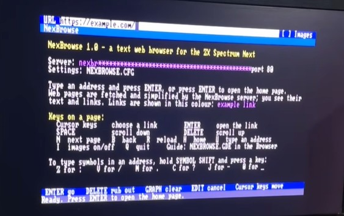
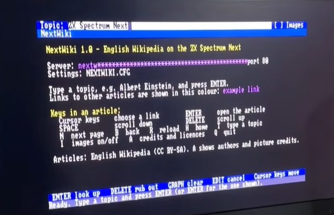

NexBrowse is a web browser for the Spectrum Next

Works best for websites with text and images that can be browsed such as https://www.specnext.com.

There's no feature for submitting forms such as Google search. 

----

NextWiki is a web client to display Wikipedia content on the Spectrum Next

----

Both apps have GDE files for help on the Next

----

Configuration:

Both apps have .cfg files

The lines:

  server=

  key=

need configuring with values for the software to work.

----

Proof of Concept only. May well break, especially if overloaded.

Component part Six Labors license for the web service is temporary and will expire after some time.
